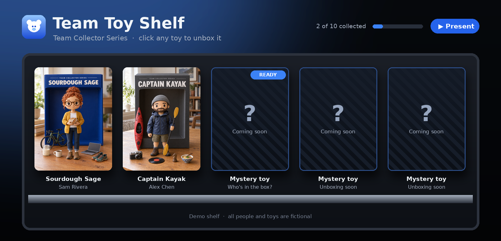
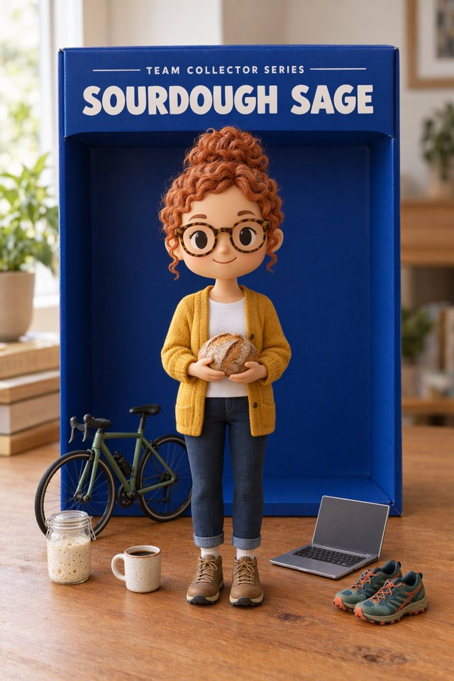
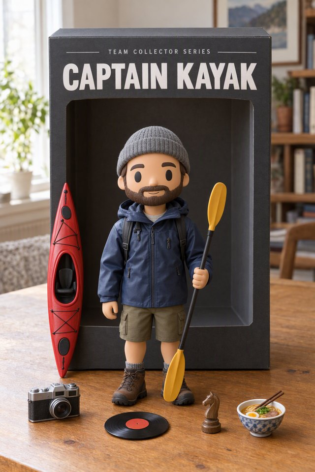
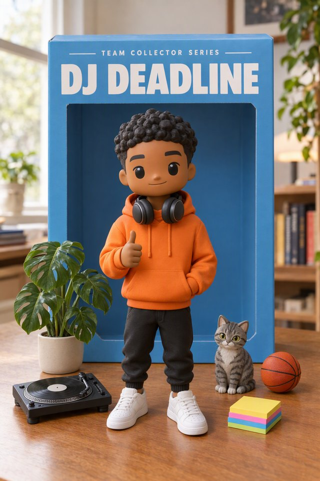
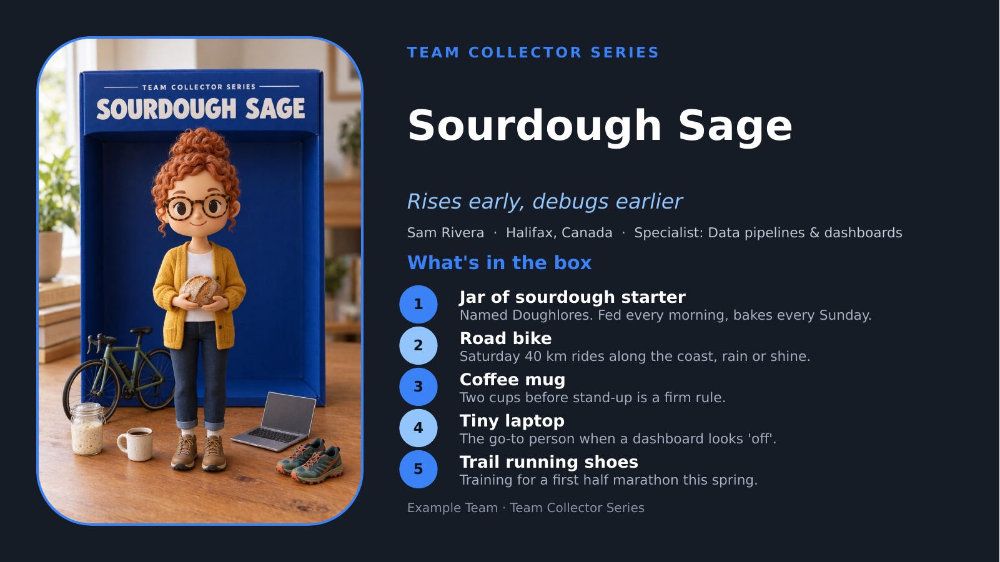
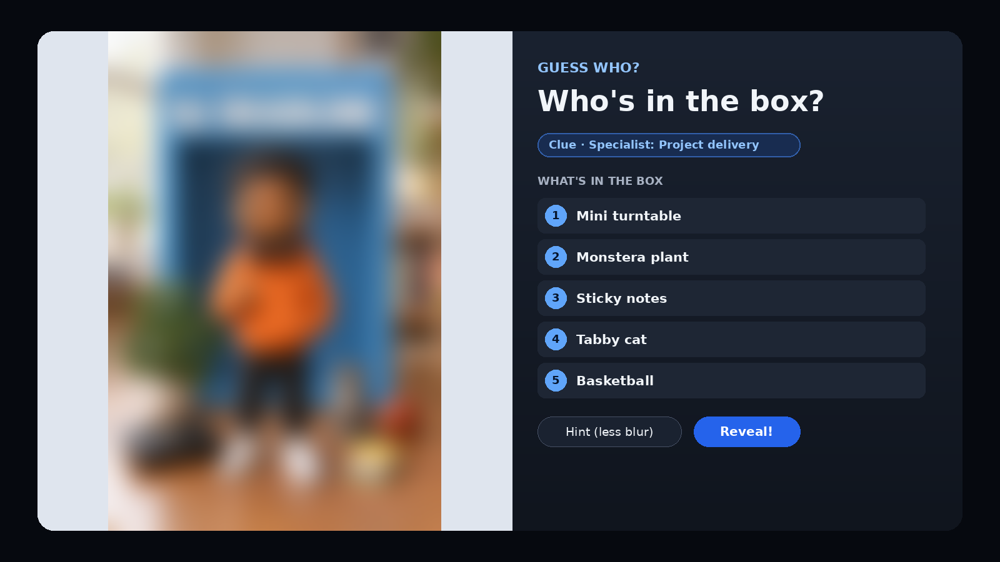

This one's a little different from my usual Power BI deep dives. No incremental refresh. No licensing diagrams. Just toys.

Well... AI-generated toys of your coworkers. Stick with me, it's better than it sounds.

## The problem: we know the job titles, not the humans

Most of us work on teams spread across cities, time zones and sometimes continents. We know each other as a Teams tile, a job title and a voice that occasionally says "sorry, you go ahead" at the same time as someone else.

What we usually *don't* know is that the person who quietly fixes your broken pipeline bakes sourdough every Sunday. Or that the calmest person on the escalation call coaches a team of very small, very loud hockey players on the weekend.

Traditional icebreakers try to fix this, and... you know how those go. "Tell us a fun fact about yourself." Cue 10 people panicking about what counts as fun.

I wanted something that was:

- **Personal, not professional.** Hobbies, pets, passions, quirks.
- **Low effort.** No design skills and no hour-long prep.
- **Actually fun to watch** in a team meeting.
- **A good excuse to use AI** in a way that isn't writing another status report.

## Where the idea came from: The Garage

A couple of years ago I took part in the **SkillUp AI DOcathlon**, a series of hands-on AI challenges run by **The Garage at Microsoft** as part of the Microsoft Hackathon. One of those challenges was called **Toy Yourself**, created by **Stacey Mulcahy**. The idea was simple and brilliant: use generative AI to turn yourself into a collectible toy, box and accessories included.

I loved it. I earned the badge, kept the picture and never quite let the idea go.

This year, when my team needed a better way to get to know each other, I went back to that challenge and asked: what if we turned it into a team ritual?

## So what is Toy Yourself (team edition)?

Each teammate uses an AI assistant to turn themselves into a **collectible vinyl toy**, with a box, a punny name, a tagline and **five tiny accessories** that represent who they are outside of work.

Then, one teammate each week presents their toy at the start of a team meeting. But first, there's a twist...

### Step 1: The AI interview

The AI interviews you, one question at a time: hobbies, family or pets (only what you want to share), where you're from, a secret skill, your favourite snack, the thing on your desk with a story behind it. You can skip anything.

At the end, it gives you a "Toy Spec Sheet" and a list of possible accessories.

> 💡 **Specific beats generic.** "I bake sourdough every Sunday and named my starter Doughlores" makes a much better accessory than "I like baking."

### Step 2: Pick a concept and generate the toy

The AI pitches three toy concepts (superhero, retro, sporty... whatever fits), you pick one, and it generates the picture. Everyone uses the **same "series style" prompt**, so every toy looks like it belongs in the same collector set: a real-looking vinyl figure on a desk, standing in front of its box, surrounded by its accessories.

| | | |
|:---:|:---:|:---:|
|  |  |  |
| **Sourdough Sage** *Rises early, debugs earlier* | **Captain Kayak** *Paddles upstream so you don't have to* | **DJ Deadline** *Drops beats, never deadlines* |

*(These are fictional examples, not real teammates. Sadly, nobody on my team named their sourdough starter Doughlores. Yet.)*

### Step 3: The Toy Card

Copilot generates the **Toy Card** text and a **five-minute presentation script**, so nobody has to stare at a blank page. You put the picture, toy name, tagline and five accessories into the one-slide PowerPoint template, with **Copilot in PowerPoint** to help assemble the slide. Review the result and paste the script and Toy Card text into the speaker notes.

Preparing your toy and Toy Card takes about **25 to 30 minutes** per person, depending on how much time you want to put into it. This is a framework, not a prescription: keep it simple or spend a little longer making it your own.

### Step 4: Guess Who? 🕵️

This is where it gets fun. Every Toy Card goes to a **curator**, who adds it to a shared **Toy Shelf** as a hidden mystery box.

On presentation day, the curator opens the box and the team sees a **blurred** toy, with its accessories as clues. Everyone guesses. The curator clicks **Hint** to sharpen the picture a bit. More guessing. Then... **Reveal!** 🎉

Then the presenter takes over and spends five minutes walking the team through what's in their box.

### Step 5: The Toy Shelf

Every revealed toy joins the **Toy Shelf**, a single HTML page that shows the whole collection. Click any toy and it pops out full size with its story and accessories. It's also a great way for new hires to meet everyone.

A few things I was deliberate about:

- **It's one offline file.** No server, no sign-up, no tracking. Pictures live inside the file.
- **Mystery toys stay secret.** The curator's private copy has everything. The "team view" export only includes toys that have already been revealed.
- **The curator's job is tiny.** About five minutes per toy.

To add a toy, copy the speaker notes from the PowerPoint slide and paste them into the Toy Shelf's Curator mode in your browser. Click "Fill in from Toy Card" to automatically populate the fields from the Toy Card text in the notes, then add the picture and check the details. You can also fill in or edit the fields manually. No PowerPoint file import is needed.

## How I built it: Copilot Cowork 🤖

Here's the fun part: I didn't build this kit by hand. The whole thing was built with **Microsoft 365 Copilot Cowork**, working alongside me as I went.

Cowork helped me:

- **Design the activity**: the flow, the timings, the Guess Who twist and the ground rules
- **Write and test the AI prompts** in the participant guide, including the "series style" prompt that keeps every toy looking like part of the same set
- **Build the Toy Card template**, the one-slide PowerPoint everyone fills in
- **Build the Toy Shelf**: the interactive web page, Curator mode, the blur-and-reveal Guess Who and the "Fill in from Toy Card" button that populates the fields from pasted speaker notes
- **Write the curator guide** and keep everything in sync as the design changed
- **Get it ready to share publicly**: strip out internal names and hidden document details, re-skin it in neutral colours, create fictional demo toys and write the README, rollout plan and customization guide

My job was mostly to describe what I wanted, react to what came back and say "no, more like this." Which, now that I think about it, is pretty much what the teammates do when they build their toys. 😄

One practical detail is the handoff from PowerPoint to the shelf. The prompt produces consistent labels like "Toy name:" and "Accessory 1:", which the shelf uses to find the details in the pasted notes. That gives the curator a quick way to populate the fields without having to retype everything.

## How it's going

We've started introducing **one teammate per week** this way. The best part is that it takes the stress out of presenting about yourself: there's a consistent, pre-built structure, so nobody has to figure out where to start.

Everyone knows what to expect, everyone has been able to put their toy together easily, and we're getting to know each other in a fun way. The framework gives us a shared starting point, but each person makes it their own.

## Why it works

- **Guess Who breaks the ice before the presenter even speaks.** By the time they share their screen, everyone's already laughing and invested.
- **Accessories are natural conversation starters.** "Wait, you DJ?" turns into a five-minute chat the next week.
- **The AI does the creative heavy lifting.** People who'd never call themselves creative end up with something they're genuinely proud of.
- **It's a gentle, useful introduction to AI.** People practise prompting, iterating and fixing an image, without any pressure, on a topic they know better than anyone: themselves.
- **It builds up over time.** Watching the shelf fill week by week gives the team something to look forward to.

## A few ground rules

These matter, so I baked them into the guide:

- **Participation is optional.** Get each person's permission before sharing their picture or story beyond the team.
- **Share only what you're comfortable sharing.** "Skip" is always an option.
- **Only upload a photo of yourself, or none at all.** Represent family and friends with symbols: a tiny jersey or a pet bowl with a name on it.
- **No confidential work details** on the box. No customer names or internal project names.
- **Follow your organization's AI policies** about which tools to use and what to share with them.

## Try it with your team

I've packaged everything up on GitHub so you can run it with your own team:

👉 **[Toy Yourself on GitHub](https://github.com/rosscouldrey/toy-yourself)**

Inside you'll find:

- **A participant guide** with every AI prompt, ready to copy and paste
- **The Toy Card slide template**
- **The Toy Shelf** (one HTML file, easy to re-skin with your own colours and team name)
- **A curator guide** for running the shelf and Guess Who
- **A rollout plan**, customization guide and ready-to-post announcements
- **A demo shelf** with fictional toys so you can try it in 60 seconds

This kit was **built and tested with Copilot** and works best with **Microsoft 365 Copilot, PowerPoint and Copilot in PowerPoint**. Copilot handles the interview, toy concepts, image generation and written content; PowerPoint is where you assemble and present the Toy Card, with Copilot in PowerPoint to help with the slide.

The framework is easy to adapt to other AI tools. Use an assistant that supports chat and image generation, then assemble the Toy Card in your preferred slide tool and add the script and Toy Card text to its speaker notes. The prompts and template give you the structure; the amount of manual assembly will depend on the tools you use.

## Thank you, Garage 💙

I couldn't write this post without saying thank you to The Garage.

The Garage and the Microsoft Hackathon give people across the company permission to play: to pick up a new skill, try a tool they'd never touched, team up with strangers from the other side of the org chart and build something just because it's interesting. The DOcathlon challenges are a perfect example. They're small, fun and approachable, and they've quietly taught a lot of us how to work with AI.

Toy Yourself is one tiny example of what happens when you give people room to be curious. An idea from a small hackathon challenge in 2024 turned into something my team uses to connect today, and now, hopefully, something your team can use too.

A few special thank-yous:

- **Stacey Mulcahy**, for creating the original Toy Yourself challenge and for being so generous about sharing it.
- **John Westworth**, Director of the Vancouver Garage, for his leadership in building a place where so many of us could learn, experiment and get inspired. (And for pointing me to Stacey!)
- **Everyone at The Garage**, for the events, challenges and community that have sparked so many ideas, this one included. 🙏

---

*If you run Toy Yourself with your team, I'd love to hear how it goes. Open an issue on the [GitHub repo](https://github.com/rosscouldrey/toy-yourself). And if your toy has a better name than Sourdough Sage, I want to see it.*

*This is a personal project. It isn't an official Microsoft product and isn't endorsed by Microsoft.*
